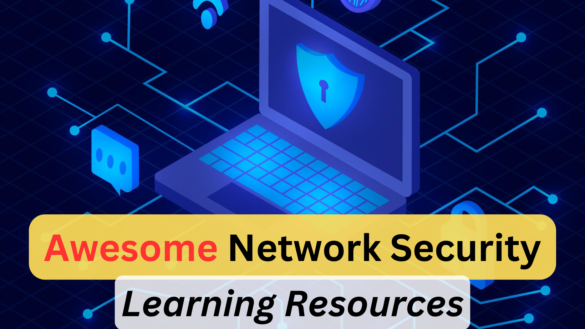

# Awesome Network Security Learning Resources

## ToC
1. [Books](#books)
2. [Videos](#videos)
3. [Free/Paid Courses](#freepaid-courses)
4. [Free/Paid Labs](#freepaid-labs)
5. [Network Security Tools](#network-security-tools)
6. [Certifications](#certifications)
7. [Blogs/Articles](#blogsarticles)

## Books
1. [Cryptography and Network Security by Forouzan](https://amzn.to/3Y999KS)
2. [Real World Cryptography by David Wong (Manning)](https://amzn.to/3TStBNO)
3. [Network Security Assessment by Chris McNab (O'Reilly, 3rd ed)](https://www.oreilly.com/library/view/network-security-assessment/9781491910955/)
4. [TCP/IP Illustrated, Vol 1 by W. Richard Stevens](https://www.informit.com/store/tcp-ip-illustrated-volume-1-the-protocols-9780321336316)
5. [Practical Packet Analysis by Chris Sanders (No Starch)](https://nostarch.com/packetanalysis3)
6. [The Practice of Network Security Monitoring by Richard Bejtlich (No Starch)](https://nostarch.com/nsm)
7. [Attacking Network Protocols by James Forshaw (No Starch)](https://nostarch.com/networkprotocols)
8. [Serious Cryptography by Jean-Philippe Aumasson (No Starch)](https://nostarch.com/seriouscrypto)
9. [Onion Routing Anatomy by Alessandro Greco](https://github.com/aleff-github/onion-routing-anatomy) - Free, open-source technical book on the Tor protocol, available in five languages, with 20 reproducible private-network laboratories.

## Videos
1. [Professor Messer - Network+ and Security+ free training](https://www.youtube.com/@professormesser)
2. [Chris Greer - Wireshark & packet analysis](https://www.youtube.com/@ChrisGreer)
3. [David Bombal - networking + security](https://www.youtube.com/@davidbombal)
4. [NetworkChuck](https://www.youtube.com/@NetworkChuck)
5. [SANS Network Security webcasts](https://www.sans.org/webcasts/)

## Free/Paid Courses
1. [Coursera: Network Security & Database Vulnerabilities (Free/Paid)](https://www.coursera.org/learn/network-security-database-vulnerabilities) - 
This course covers core principles of network security, network vulnerabilities, and countermeasures. 
2. [Cybrary: Network Security Fundamentals](https://www.cybrary.it/course/cyber-network-security) - 
Free video-based training on network security basics, threat modeling, and various network attack methods.
3. [Udemy: The Complete Cyber Security Course - Network Security (Paid)](https://www.udemy.com/course/network-security-course/?couponCode=LEARNNOWPLANS) - 
Comprehensive course on network security, including encryption, VPNs, firewalls, and malware protection.
4. [edX: Network Security (Paid)](https://www.edx.org/learn/network-security/rochester-institute-of-technology-network-security) - 
A full course that covers network security principles, including firewalls, intrusion detection, and more.

## Free/Paid Labs
1. TryHackMe
2. HackTheBox
3. [Cisco Networking Academy Labs (Free)](https://www.netacad.com/) - Free labs covering network security principles, firewall configurations, and intrusion prevention systems.
4. [Pentester Academy (Paid)](https://www.pentesteracademy.com/) - A paid service offering network labs focused on penetration testing, network security analysis, and malware forensics.

## Network Security Tools
### Discovery / scanning
1. [nmap](https://nmap.org/) - De-facto network scanner.
2. [masscan](https://github.com/robertdavidgraham/masscan) - Internet-scale scanner.
3. [rustscan](https://github.com/RustScan/RustScan) - Fast wrapper around nmap.
4. [Naabu by ProjectDiscovery](https://github.com/projectdiscovery/naabu)

### Packet capture / analysis
5. [Wireshark](https://www.wireshark.org/) / [tshark](https://www.wireshark.org/docs/man-pages/tshark.html)
6. [tcpdump](https://www.tcpdump.org/)
7. [Zeek (formerly Bro)](https://zeek.org/) - Network analysis framework.
8. [NetworkMiner](https://www.netresec.com/?page=networkminer) - Forensic PCAP analysis.

### Vulnerability scanners
9. [OpenVAS / Greenbone](https://greenbone.github.io/docs/)
10. [Nessus (Tenable)](https://www.tenable.com/products/nessus)
11. [Qualys VMDR](https://www.qualys.com/apps/vulnerability-management-detection-response/)
12. [Rapid7 Nexpose / InsightVM](https://www.rapid7.com/products/insightvm/)

### Exploitation / MITM
13. [Metasploit Framework](https://www.metasploit.com/)
14. [netcat / ncat](https://nmap.org/ncat/)
15. [ettercap](https://www.ettercap-project.org/) - MITM attacks.
16. [bettercap](https://www.bettercap.org/) - Modern MITM toolkit.
17. [Responder](https://github.com/lgandx/Responder) - LLMNR/NBT-NS/MDNS poisoning.
18. [Impacket by Fortra](https://github.com/fortra/impacket) - Core network protocol toolkit (Windows AD attacks).
19. [CrackMapExec / NetExec](https://github.com/Pennyw0rth/NetExec) - Network swiss-army knife for pentesters (NetExec is the maintained fork).

### Wireless
20. [aircrack-ng](https://www.aircrack-ng.org/)
21. [Kismet](https://www.kismetwireless.net/)
22. [hcxdumptool / hcxtools](https://github.com/ZerBea/hcxdumptool) - WPA/WPA2 capture.

### IDS / IPS / NDR
23. [Snort 3](https://www.snort.org/)
24. [Suricata](https://suricata.io/)
25. [Zeek](https://zeek.org/)
26. [Security Onion](https://securityonionsolutions.com/) - All-in-one NSM/IDS distro.

### Crypto & TLS
27. [OpenSSL](https://www.openssl.org/)
28. [testssl.sh](https://testssl.sh/) - TLS configuration auditing.
29. [sslyze](https://github.com/nabla-c0d3/sslyze)

### Monitoring
30. [Nagios](https://www.nagios.org/) / [Zabbix](https://www.zabbix.com/) / [Prometheus](https://prometheus.io/)

## Certifications
1. [CompTIA Network+](https://www.comptia.org/certifications/network) - Vendor-neutral networking foundation.
2. [CompTIA Security+](https://www.comptia.org/certifications/security)
3. [SSCP by ISC2](https://www.isc2.org/certifications/sscp)
4. [EC-Council Certified Network Defender (CND)](https://www.eccouncil.org/programs/certified-network-defender-cnd/)
5. [Cisco CCNA / CCNP Security](https://learningnetwork.cisco.com/s/security)
6. [Cisco Certified CyberOps Associate / Professional](https://learningnetwork.cisco.com/s/cyberops-associate)
7. [GCIA / GCIH / GNFA by SANS GIAC](https://www.giac.org/) - Network-focused blue-team certs.
8. [Juniper JNCIS-SEC / JNCIP-SEC](https://www.juniper.net/us/en/training/certification.html)
9. [OSCP / OSEP by OffSec](https://www.offsec.com/) - Offensive-side, includes significant network work.

## Blogs/Articles
1. [SANS Internet Storm Center diary](https://isc.sans.edu/diary.html)
2. [Troy Hunt's blog](https://www.troyhunt.com/)
3. [Krebs on Security](https://krebsonsecurity.com/)
4. [NCSC UK technical guidance](https://www.ncsc.gov.uk/section/advice-guidance/all-topics)
5. [RFCs worth reading: 9110 (HTTP Semantics), 9293 (TCP), 8446 (TLS 1.3), 9000 (QUIC)](https://www.rfc-editor.org/)
6. [MITRE ATT&CK - Enterprise: Network tactics](https://attack.mitre.org/tactics/enterprise/)
7. [Chris Sanders - packet analysis blog/courses](https://chrissanders.org/)
8. [The Packetlife cheatsheets](https://packetlife.net/library/cheat-sheets/)
9. [NSA/CISA - Network Infrastructure Security Guidance (2022)](https://media.defense.gov/2022/Jun/15/2003018261/-1/-1/0/CTR_NSA_NETWORK_INFRASTRUCTURE_SECURITY_GUIDE_20220615.PDF)
10. [Zero Trust Architecture - NIST SP 800-207](https://csrc.nist.gov/publications/detail/sp/800-207/final)